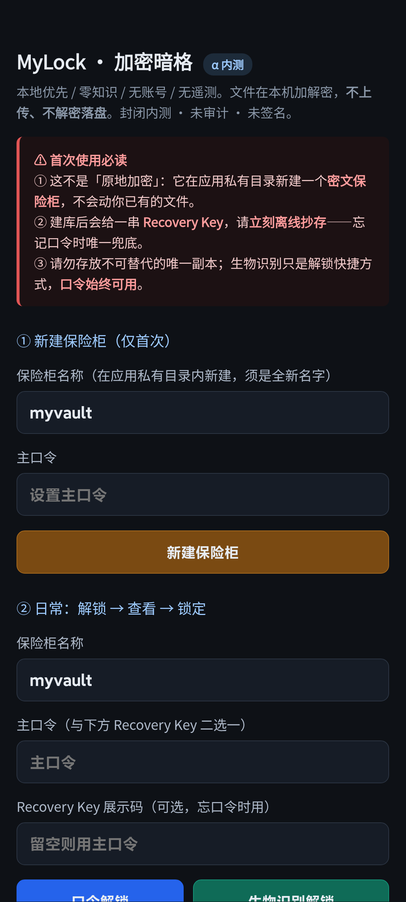
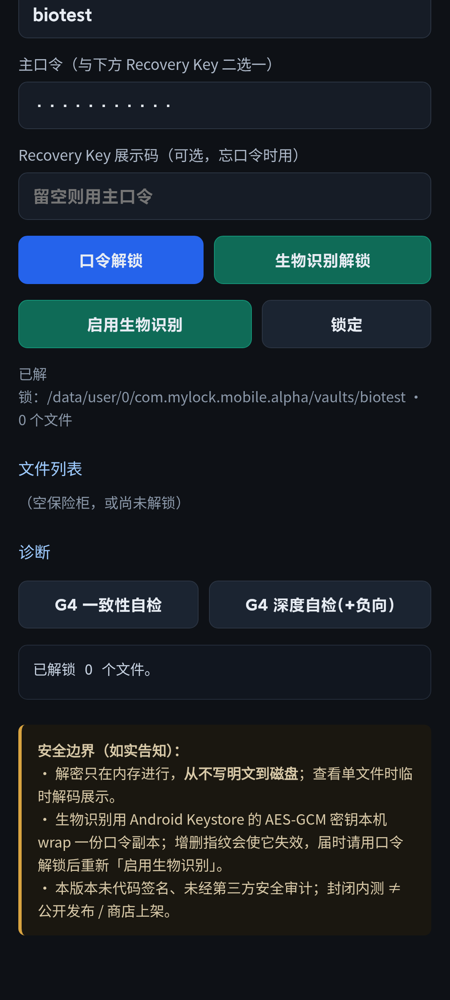
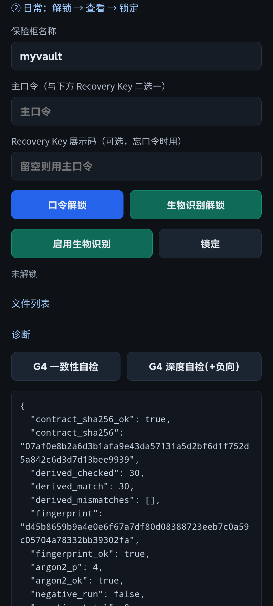
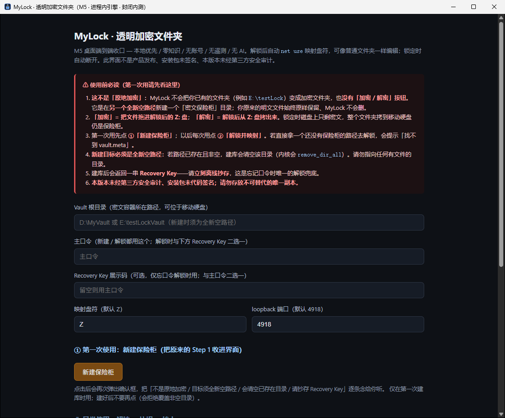
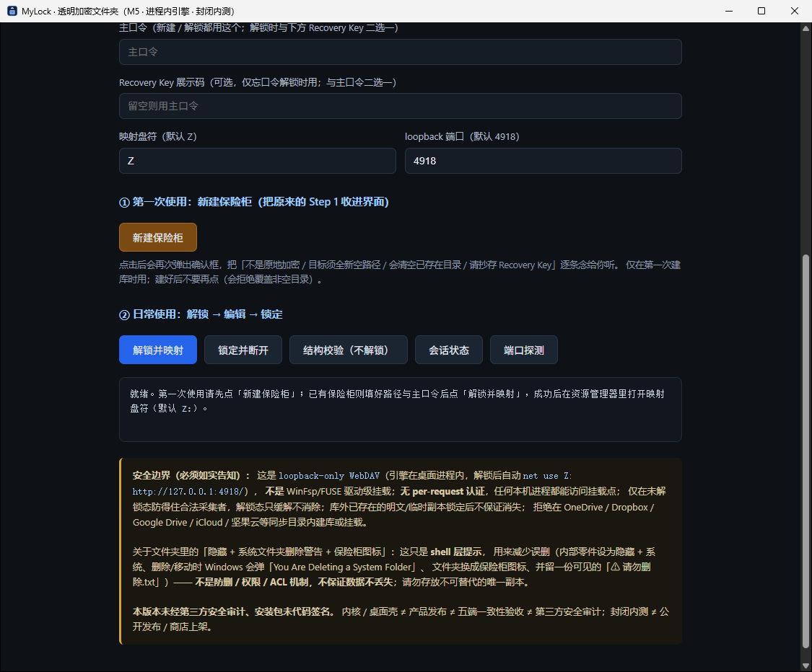

# MyLock

> **本地优先、零知识、多端同钥的私人数据保险柜。**

MyLock 把本机的一组文件加密成一个**静态的普通文件目录（vault）**。拔掉存放介质后，它是「谁也打不开的保险柜」；插回装了 MyLock 的设备、输一次口令，它又变回你原来那个文件夹。

**No Cloud · No AI · No Telemetry · No Account。** 没有服务端、没有账号体系、没有遥测、没有埋点、没有 AI。开发者/公司从不接收、看不到、也无法访问你的文件、口令、密钥或使用数据。

---

## ⚠️ 请先看这里：项目状态与诚实边界

本项目目前是 **v0.1.0 / alpha / 邀请制封闭内测**，**尚未公开发布**。

- ❌ **未经第三方安全审计**（internal 密码学评审 ≠ 第三方审计）
- ❌ **未代码签名、未产出可分发安装包**（桌面为未签名便携包；Android 为 debug 调试签名、可侧载 APK，均仅供内测）
- ❌ **未上架任何应用商店**
- 🟢 **Android 最小可用已实现并真机验收**（封闭内测/debug 签名，详见下文），可侧载 APK；**iOS 仍未实现**
- ⚠️ **请勿存放不可替代的唯一副本**——现在是内测软件，不是备份产品的替代品

对外发布的四道外部闸门（A 第三方安全审计 / B 律师签发 / C 代码签名 + 可分发包 / D 商店申报）**全部未完成**。本仓库是**开源源码发布**，不等于**产品发布 / 上架 / 合规认证**。

项目文档中的合规清单、白皮书、隐私政策均为**草案**，不是法律意见、不是审计报告、不是安全认证。措辞与抓取时点以各文档内标注为准。

详见 [项目总结报告.md](项目总结报告.md)、[BETA-NOTICE.md](BETA-NOTICE.md)、[prelaunch-checklist.md](prelaunch-checklist.md)、[security-whitepaper.md](security-whitepaper.md)。

---

## 它解决什么问题

云同步客户端、OS 索引、桌面搜索、备份与遥测，会在你**已授权**的前提下把明文复制走。MyLock 的目标不是「更强的 TLS」（传输加密早已被 TLS 解决），而是**让明文根本不出现在这些采集器能读到的地方**。

必须诚实的边界（详见 [threat-model.md](threat-model.md)）：

- ✅ **仅未解锁态**防得住「合法采集者」：盘上永远是密文，采集器只能拿走乱码。
- ⚠️ **解锁态仅缓解**：一旦解锁并把 vault 暴露为可读写文件夹，运行中的明文就在内存与挂载点里，任何本机进程或能读该挂载点的采集器都可能拿到。这是「透明文件夹」形态的固有代价，不是可修补的缺陷。
- ⚠️ **零吊销（zero revocation）**：`change-password` / `rotate-recovery` 不会撤销旧凭据；真正吊销需要 `rotate-keys` 并物理销毁旧介质。
- ❌ 不防「设备已攻陷」「解锁态截屏」「所有凭据同时丢失」等场景。

---

## 功能现状

| 端 | 形态 | 状态 |
|---|---|---|
| **桌面（Windows）** | 透明加密文件夹：把 vault 通过 loopback WebDAV 映射为 OS 盘符（如 `Z:`），**非驱动级**（非 WinFsp/FUSE） | ✅ 已实现并本机验收 |
| **恢复 CLI** | `mylock` 命令行，9 个命令（见下） | ✅ 已实现并本机验收 |
| **Android** | 生物识别暗格（Tauri 2 + 自定义 Kotlin mobile plugin，复用唯一 mylock-core） | 🟢 最小可用已实现并真机验收（封闭内测 / debug 签名 / 未上架，见下） |
| **iOS** | 生物识别暗格 | 🔴 仅可行性设计，**未实现** |

核心能力：
- 解锁后通过 `net use` 自动映射 / 断开一个 WebDAV 盘符，写入即加密、读回即解密。
- 全量 copy-on-write 写回（未变对象复用原密文，不重加密；但每次写回仍重建整份 manifest，**不是增量日志**）。
- 拒绝云同步根内挂载、端口占用/损坏容器/口令错误在返回前端前即可透传错误码。
- 结构校验（两阶段 `verify`：解锁前结构 + KDF 硬校验；解锁后逐对象逐 chunk 重算认证）。

详细用法见 [USER-GUIDE.md](USER-GUIDE.md)（演示口令 `My-Demo-Pw-2026`）。

### CLI 命令

`mylock info` / `verify` / `create` / `export` / `export-object` / `change-password` / `rotate-recovery` / `rotate-keys` / `mount`（mount 命令在独立 CLI 中拒绝执行，桌面层负责实际映射）。

> 注意：`create` 会清空（`remove_dir_all`）已存在的目标目录——**务必指定一个全新的空路径**。`export` 会摊平目录层级。

---

## 界面截图

以下截图均为封闭内测版本机/真机实拍，非概念图。图片源文件在 [docs/screenshots/](docs/screenshots/)。

### Android（arm64，Redmi / Android 12 真机）

主界面：新建保险柜、口令/Recovery Key 解锁、生物识别解锁、诊断自检入口。



解锁后状态与文件列表（明文仅在内存，不落盘）。



G4 一致性自检真机结果：30/30 derived、指纹 `d45b8659…02fa`、p=4、`ok=true`。



### Windows 桌面（透明加密文件夹，M5 进程内引擎）

主界面：使用前必读、vault 根目录、主口令/Recovery Key、盘符与 loopback 端口。



日常操作区：新建保险柜、解锁映射、结构校验与状态。



> 说明：两端均为 alpha 封闭内测界面，Android 为 debug 调试签名、未上架；截图不构成发布或审计结论。

---

## 密码学设计（已落地）

| 环节 | 算法 / 参数 |
|---|---|
| KDF | Argon2id，m=65536 KiB、t=3、p=4、tag=32B、salt=16B（**必须显式 p=4**；libsodium `crypto_pwhash` 硬编码 p=1，跨端会解锁失败） |
| 主密钥包裹 | RFC 3394 AES-256-KW，把 `Master(32B) ‖ MAC_Key(32B)` 包成 72B 存 `vault.meta` |
| 密钥派生 | HKDF-Expand(SHA-256) 域分离（`wrap/password`、`wrap/recovery`、`meta-version-mac`、`manifest`+id、`object`+id） |
| 内容/清单加密 | XChaCha20-Poly1305，24B 随机 nonce、16B tag，1 MiB 分块，每块独立 nonce/tag |
| 防降级 | `versionMac = HMAC-SHA256(...)` 覆盖整个 meta 头，解锁后比对（失败 `E_DOWNGRADE`） |
| 名称 | 密文名 = 128-bit CSPRNG → base32（大写、无填充、26 字符），前 2 字符分片 |

格式层是成熟范式组合、**非创新密码学**；XChaCha20-Poly1305 属 non-standard/non-IETF 构造（残余风险 R10）。完整规范见 [vault-format-spec.md](vault-format-spec.md)、[crypto-review-m1.md](crypto-review-m1.md)、[security-whitepaper.md](security-whitepaper.md)。

---

## 仓库结构

```
core/                    Rust workspace
  crates/mylock-core/    核心库：密码学 + vault 格式 + 写回
  crates/mylock-cli/     恢复 CLI（mylock 命令）
  crates/mylock-mount/   loopback WebDAV 挂载层
desktop/src-tauri/       Tauri 桌面壳（Windows；Tauri 2.x + Vite 前端）
poc/                     M1 概念验证（Python 产出源 + test-vectors.json）
tests/vectors/           G4 逐字节契约归档 + SHA-256 锚 + CONTRACT.md
tools/                   校验/审计/指纹/构建辅助脚本
dist/                    内测便携包（未签名，非源码，不纳入源码仓库）
.github/workflows/       vectors.yml：G4 三平台 CI 门禁
*.md                     设计/调研/报告/合规草案文档
```

**研究/设计文档**（这些不是发布前置，而是设计说明与社区评估材料）：
[local-first-privacy-research.md](local-first-privacy-research.md)（竞品与密码学）、[mobile-vault-research.md](mobile-vault-research.md)（移动端平台能力）、[产品分析与概要设计.md](产品分析与概要设计.md)（总设计）、[threat-model.md](threat-model.md)（威胁模型）。

---

## 从源码构建

工具链（本仓库验证时点）：`rustc/cargo 1.100.0 stable (x86_64-pc-windows-gnu)`、Tauri 2.12.5、Node v24.21.0。

```powershell
# 1. 核心 workspace：测试（含 KAT / conformance / vectors / mount 共 26 项）
cd core
cargo test --workspace --locked
cargo build --workspace --locked

# 2. 桌面壳（Tauri；前端依赖先装）
cd desktop/src-tauri
npm install
cargo check
```

> 桌面打包目标配置为 `nsis` / `msi`，但**当前未产出可分发安装包、未代码签名、证书自备**；本仓库不提供任何证书或密码（见 [desktop/SIGNING.md](desktop/SIGNING.md)）。

---

## 测试向量与 G4 一致性契约

`tests/vectors/test-vectors.json`（13499 B，SHA-256 `07af0e8b…9939`）是唯一逐字节契约，`.gitattributes` 对其设了 `-text`，**禁止 CRLF 归一化**（会破坏 SHA-256 锚）。

- ✅ Windows / Rust 内核 / 恢复 CLI：**已验收**
- 🟡 macOS / Linux：CI 已配置（[vectors.yml](.github/workflows/vectors.yml)），**未实跑**（推送到 GitHub 启用 Actions 后才跑）
- 🟢 Android：**真机已验收**（Redmi M2004J7BC / Android 12 / arm64），同一份 test-vectors.json 达 30/30 derived、13/13 negative、指纹 `d45b8659…02fa`、p=4 Argon2id、`ok=true`；生物识别与口令双路解锁结果逐字段一致。可侧载 APK：`dist/mylock-android-arm64-v0.1.0-alpha-debug.apk`（debug 签名，仅供内测，未上架）
- 🔴 iOS：**未实现**

CI 尚未在本机以外跑过，推送后请留意首次实跑结果。详见 [tests/vectors/CONTRACT.md](tests/vectors/CONTRACT.md)。

---

## 许可证

第一方源码采用**双许可 `MIT OR Apache-2.0`**——由使用者任选其一（与 `core/Cargo.toml`、`desktop/src-tauri/Cargo.toml` 中的 `license` 字段一致）：

- [LICENSE-MIT](LICENSE-MIT)
- [LICENSE-APACHE](LICENSE-APACHE)

版权归 dianfengsoft。第三方依赖的许可见 [THIRD_PARTY_NOTICES.md](THIRD_PARTY_NOTICES.md)（以及 `dist/MyLock-Beta-0.1.0/THIRD_PARTY_NOTICES.md`）。

**依赖许可诚实口径**：可核验范围内 **无 GPL 家族强 copyleft（已核验 0）**，但**存在 MPL-2.0 文件级弱 copyleft**（如 `htmlescape 0.3.1`）。不要对外宣称「没有任何 copyleft」。该口径为 2026-11-15 抓取时点值，准确措辞与逐包明细见 [zerocost-compliance-report.md](zerocost-compliance-report.md) 与 [prelaunch-checklist.md](prelaunch-checklist.md)。

---

## 商业化原则（项目约束）

桌面端免费引流 + 移动端一次买断；**绝不订阅、广告、数据变现**。开源 ≠ 出口管制豁免：自研 XChaCha20-Poly1305 属 non-standard cryptography，公开源码不自动豁免 EAR / 欧盟两用物项管制——这是未来商业化/上架时的事，本项目当前不做出口管制主张。

---

## 贡献

欢迎 issue 与 PR。在动手前请阅读 [tests/vectors/CONTRACT.md](tests/vectors/CONTRACT.md)（字节级契约不可随意改动，改动任何格式字节需升 `format` 并重新冻结全部锚）和 [threat-model.md](threat-model.md)。

安全漏洞请按负责任披露方式私下报告，勿在公开 issue 中披露可利用细节。
